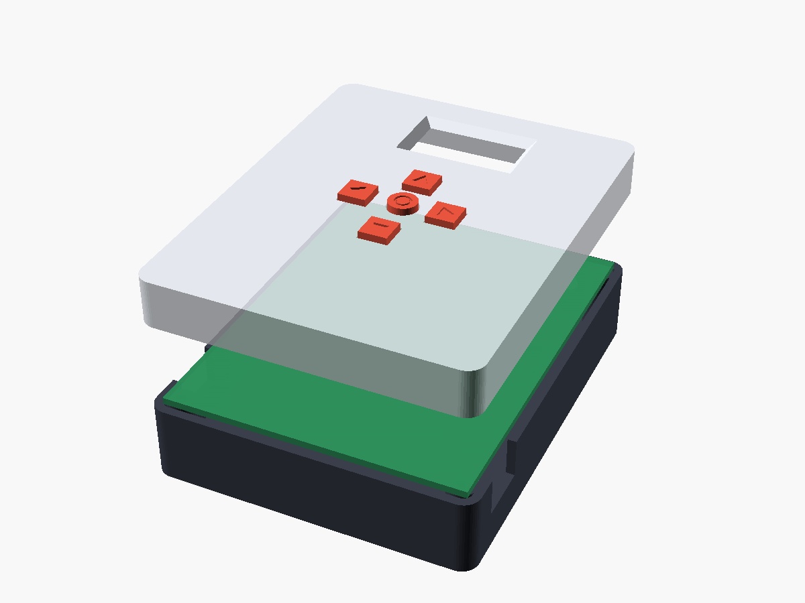
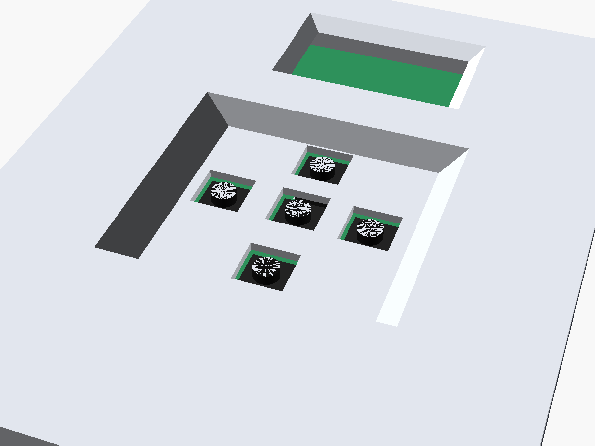
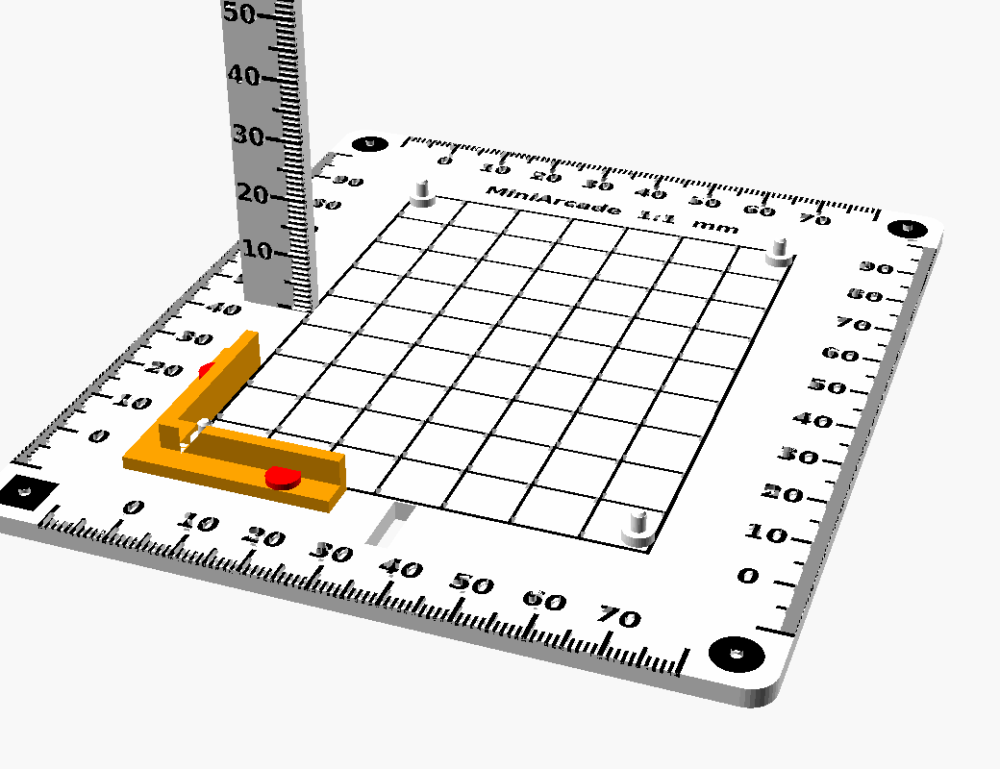
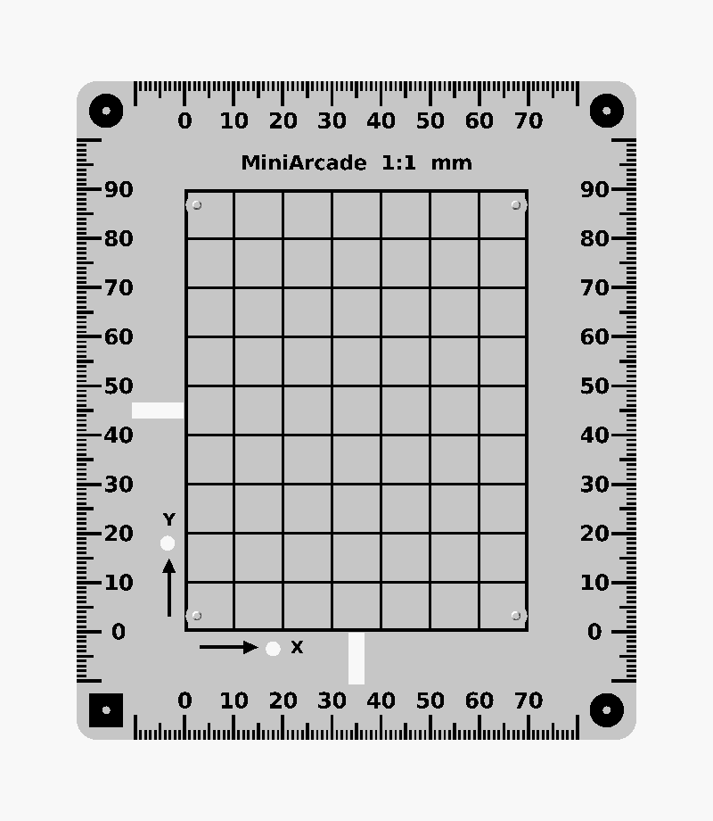

# MiniArcade case

3D printable case for the 70 x 90 mm perfboard. Everything is in
`miniarcade_case.scad` (OpenSCAD); the STL files next to it are rendered
from it and ready for the slicer.

| file | what | print |
|---|---|---|
| `testplate.stl` | 1.2 mm plate the size of the board - print this first | flat, ~10 min |
| `bottom.stl` | back shell: pegs for the board, battery guides, USB-C openings, switch hole, sound holes | floor down |
| `lid.stl` | front: display window, a funnel around each button, spring tabs | front face down |
| `plate.stl` | `bottom` + `lid` side by side, already in print position - one print job | as is |

No screws, no supports, no glue.

## Printing (Creality K2 Plus, Creality Print 7)

- Shells (`plate.stl` or `bottom.stl` + `lid.stl`): preset
  **0.20mm High Quality @Creality K2 Plus**, supports **off**, PLA (or PETG).
  15 % infill is plenty, 3 walls if you want it stiffer.
- Test plate: **0.20mm Standard** is enough.
- Don't rotate the parts: the orientation in the STL is the one that needs no
  supports.

Why no supports are needed:

- all slopes are 45 degrees or less (button funnels, the display window
  chamfer, the beads on the spring tabs, the snap groove)
- the switch hole in the wall is a teardrop (pointed top)
- the only bridges are the tops of the two USB-C openings (13 mm) and the
  small ridges between neighbouring button funnels - a K2 bridges these cleanly

## Test plate first

Lay the test plate on the front of the board:

- the 4 holes sit over the corner holes of the board
- the 5 switch bodies go through their square holes without touching
- the display window frames the picture (switch the console on)
- the notches on the left / right edge point at the two USB-C sockets

If something is off, change the number in the `.scad` file (e.g. `win_c`,
`buttons`, `usb_esp`) and render again:

    openscad -D 'part="lid"'   -o lid.stl   miniarcade_case.scad
    openscad -D 'part="plate"' -o plate.stl miniarcade_case.scad

## Please measure before printing the shells

These were estimated from photos:

| parameter | now | what |
|---|---|---|
| `btn_h` | 5.0 | top of a button plunger above the board - the bottom of each funnel sits there |
| `front_h` | 7.5 | tallest part on the front (display module) plus a little room |
| `back_h` | 16 | tallest part on the back (buzzer ~15 mm) plus room for the battery |
| `bat` | 51 x 66 x 5.5 | the Samsung battery |

If `btn_h` is a bit off the plungers only stand a little above or below the
funnel floor - the switch bodies pass through the holes either way.

## Assembly and opening

- Battery: lies in the corner guides on the floor.
- Board: front up onto the four pegs of the back shell (they go through the
  corner holes).
- Toggle switch: its M6 bushing goes through the hole in the top wall, held
  by its own nut on the outside. Move it with `switch_x` / `switch_z`.
- Lid: press it on until the four spring tabs click into the groove. Its
  bosses press the board onto the posts, so nothing rattles.
- Open: put a fingernail or a coin into the notch at the bottom edge and
  lever the lid up. If it is too tight or too loose, change `bead`
  (0.6 mm now) and print only the lid again.
- USB-C: both sockets are reachable through the openings in the side walls
  (the ESP32 on the left, the charger on the right).

## Photo plate (measuring board)

A 1:1 measuring board to put a build on and photograph, so the case can be
designed from real sizes instead of guesses. It is the same plate for every
build, so photos of different builds can be compared.

- **Board area:** the 70 x 90 mm outline with a 10 mm grid. All rulers count
  from its bottom-left corner (the arrows X and Y), so a reading is directly
  the board coordinate that `miniarcade_case.scad` uses.
- **Rulers:** mm ticks on all four edges, numbers every 10 mm.
- **Corner marks:** four of them, for straightening a slanted photo. The
  square one marks the origin corner.
- **Two slots for the height ruler:**
  - left of the board: the ruler faces the bottom edge, for photos from the front;
  - below the board: the ruler faces the side.
  - 0 on the ruler is the top of the plate.
- **Corner stop:** pushes the board into the corner at 0/0. It is held by two
  short pins.
- **Pegs:** four pegs are printed with the plate, at the board's corner
  holes. They hold the board in place; it rests on their collars, 1.5 mm
  above the plate.

| file | what | print |
|---|---|---|
| `photoplate_all.3mf` | **everything in one file**: plate and both rulers as two-part objects, stop and pins, laid out on one bed | as it is; give the "Markierungen" parts the dark filament |
| `photoplate_base.stl` + `photoplate_marks.stl` | the plate, 114 x 134 x 3 mm, with the four pegs | flat, two colours |
| `photoplate_ruler_base.stl` + `photoplate_ruler_marks.stl` | height ruler, 0..55 mm | flat, marks up, two colours (print 2) |
| `photoplate_stop.stl` | corner stop | foot down |
| `photoplate_stoppin.stl` | 2 pins for the stop | head down |

**Two colours with the CFS (Creality Print):**
1. Open the base and the marks STL **together**.
2. When Creality Print asks whether to load them as one object with several
   parts, answer **yes**.
3. Give the base a light filament (white) and the marks a dark one (black).

The marks are inlaid flush into the top 0.6 mm, so only the last three
layers change colour. Use the 0.20 mm preset with supports off.

**Taking photos:**
- **From above:** hold the phone straight above the plate, far enough away
  that all four corner marks are in the picture.
- **Heights:** take a photo from the front or the side, with the height
  ruler standing right next to the part.

`photoplate_all.3mf` is packed from the STLs by `photoplate_3mf.py`:

    python3 photoplate_3mf.py . photoplate_all.3mf
