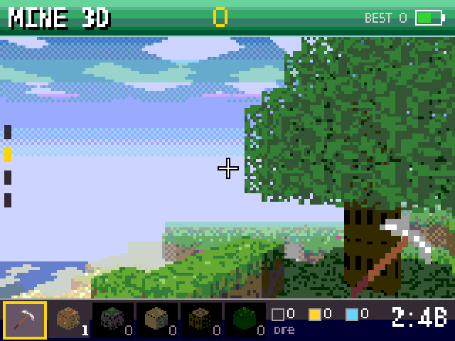
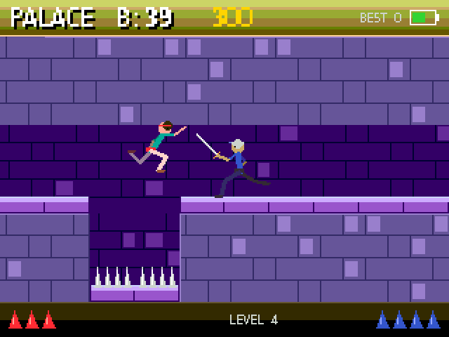
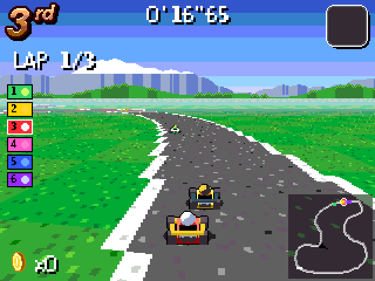

# MiniArcade Color

The colour console: a 2.4" SPI display with 320 x 240 pixels (ILI9341,
ST7789 optional), four keys, a buzzer and a battery. Its own firmware, apart
from the OLED MiniArcade: it never installs as an update on the OLED console
and the OLED firmware never on this one.

All 32 games of the OLED console, redrawn for 320 x 240 in colour: Snake,
Tetris, Pong, Doom, Mine, Tunnel 3D, Flappy, Invaders, Dino, Breakout,
Rocks, Racer, Frogger, 4 wins, Tic Tac Toe, 2048, Minesweeper, Pac-Man,
Shooter, Jump & Run, Sokoban, Battleship, Sudoku, Lights Out, Match 3,
Checkers, Mau-Mau, Bomberman, Cave, Stack, Minigolf and Lander - against
the CPU or two players on one console (and online, see below). Plus
Mine 3D, a block world in first person, Palace, a platformer, Block Puzzle,
Fruit Pot, Pumpkin Maze, a tilt labyrinth with a level editor on the phone,
Kart GP, a kart racer in the style of the 16-bit consoles,
Skat against two CPU players (all below), and Chess with all
rules (castling, en passant, promotion, check, mate, stalemate, 50 moves),
against the CPU, for two players on one console or online (the board can
turn round for black):

- **vs CPU easy / normal / hard**: you pick white or black, the board faces
  you. The CPU searches with alpha-beta (material, piece-square tables, takes
  searched on to the end) for up to 0.5 / 1 / 2.5 s: easy looks one move
  ahead and now and then plays any move, normal 3 plies, hard up to 5.
  Holding OK while it thinks opens the pause menu as usual.
- **saved game**: a game in progress is kept in flash after every move and
  when you leave it (also through sleep or switching off); the next start of
  Chess offers "continue saved game" first. A finished game, "restart" in
  the pause menu or a new game clear it.

## Mine 3D

A block world in first person: 32 x 32 x 16 blocks of grass hills, beaches,
lakes, trees, caves and stone with ore. It wraps round at the edges. Two ways
to play:

- **free play**: no time, no score - dig and build what you like with every
  kind of block (grass, dirt, stone, sand, wood, leaves, coal, gold, crystal)
  without end. The world is kept in flash (its seed and up to 1000 changed
  blocks, every 30 s and when you leave); "continue my world" brings it back.
- **ore hunt**: a new world, three minutes to dig ore: coal 1, gold 5,
  crystal 20 points; blocks to build with only from what you dug.

    LEFT/RIGHT           turn
    UP/DOWN held         walk forward / back (a step of one block is jumped)
    UP/DOWN tapped       look up / down (four steps, marked on the left)
    OK                   pick: dig the block in the middle of the view
                         block: put it on the face you look at - under your
                         own feet it lifts you up a block
    OK twice             the bag: LEFT/RIGHT choose the pick or a block, OK

Ore glints in the dark; whatever else you dig goes into the bag (grass gives
dirt). Every pixel is a ray through the block grid, all in integers, drawn at
160 x 92 and doubled.

## Palace

A nameless runner escapes from a palace dungeon: eight levels, twenty
minutes for all of them. A level is a grid of rooms of 10 x 3 tiles; the
screen flips at a room's edge. Loose tiles crumble (whole rows of them, run
over them), spikes spring out, plates open gates (others shut them again),
one plate opens the exit door. One floor down is safe, two cost a flask of
health, three kill - climbing down first saves a floor. Potions heal or add
a flask. The sword lies in the first level; guards get better level by
level, the captain waits in the sky tower, the forges and below the throne,
the Warden on his throne at the very end (nine flasks, he rages when half
are gone). Dying starts the level again, the clock runs on. Score: 100 per
level, plus the seconds left at the end.

| Level | Rooms | What waits there |
|-------|-------|------------------|
| 1 The Cellars | 3 x 1 | the sword, the first guard, a loose tile |
| 2 The Old Wells | 4 x 2 | a deep drop to climb down, loose rows, spikes |
| 3 The Guard Halls | 5 x 2 | four guards, gates and the plates that shut them |
| 4 The Sky Tower | 4 x 3 | a climb up the tower, the captain |
| 5 The Sunken Baths | 5 x 1 | water in the pits (the room mirrored in it), a timed gate behind a running jump over a pool |
| 6 The Great Library | 4 x 3 | bookshelves, a loose row to cross, hang drops, a gate shut by a plate on the way, a climb of six ledges |
| 7 The Forges | 5 x 2 | furnaces, scythes, two timed gates, molten iron below, the captain again |
| 8 The Dawn Throne | 4 x 3 | windows at dawn, all of it together, the Warden |

New in the later levels:

- **Scythes** sweep out of a slot in the floor in a steady beat (their tip
  shows just before). Wait on the tile before one until it has gone in,
  then run past - or step past carefully right after it.
- **Timed gates** (their plates are blue) fall shut again a few seconds
  after you leave the plate; a bar on the gate shows the time left, and it
  ticks. A loose tile falling onto the plate keeps such a gate open.
- **Pools**: the deepest pits of the baths hold water, those of the forges
  molten iron - a fall in is the end.

The level reached is kept: the next start offers "continue: level N" (with
the flasks of the big potions before it and 2:30 for each level left), a
new game, or any level before it. The score counts the levels played.

    LEFT/RIGHT           run
    DOWN + LEFT/RIGHT    careful step (safe on spikes, stops at an edge)
    UP + LEFT/RIGHT      jump: standing 1-2 tiles, running 3 tiles of gap
    UP                   jump up to a ledge above; hold UP to climb on
    DOWN at an edge      climb down and hang; DOWN again lets go
    OK                   draw the sword (it comes out by itself near a guard)
    with the sword       LEFT/RIGHT step, OK strike, UP parry, DOWN put away

## Block Puzzle

An 8 x 8 board and a tray of three pieces (singles, lines of 2 to 5,
squares, rectangles, L, T, S/Z and corners). Put them on the board; every
full row and column clears - several at once score a combo (10 x lines²),
clears move after move a streak (x2 ... x5). A new set of three comes when
the tray is empty; each new piece fits somewhere on the board as it is (if
anything can). Over when no piece left in the tray fits.

    LEFT/RIGHT (UP/DOWN) choose a piece in the tray, OK takes it
    arrows               move it over the board: a see-through ghost, red
                         where it does not fit; the lines it would clear
                         are framed white
    OK                   put it down
    RIGHT at the edge    back to the tray

- **classic**: endless, the high score of the library.
- **adventure**: 16 levels with a goal and a move limit - collect every gem
  (a gem goes when its row or column clears), clear every stone and ice
  block (ice cracks at the first clear and goes at the second) or reach a
  score. The level reached is kept; "continue: level N" or any level before.
- **time 2:00**: as many points as you can; every cleared line adds 3 s,
  a combo 2 s more. Its best is kept apart.
- **puzzles**: a set board and a set list of pieces - use them all and
  clear the board. The console has no clock, so the puzzles are numbered
  (#1 to #999, the same on every console): the next unsolved one is
  offered, LEFT/RIGHT (UP/DOWN by ten) pick any other.

## Fruit Pot

Drop fruits into a pot. Two equal fruits that touch become the next bigger
one at their middle: cherry, strawberry, grape, lemon, orange, apple,
peach, pineapple, coconut, melon - two melons vanish with a bang (100
points). Only the five smallest come from the dropper; the next one waits
on the left, the whole chain is on the right. Over when a fruit stays above
the red line for two seconds.

    LEFT/RIGHT held      move the dropper (or tilt the console)
    OK or DOWN           drop

The physics runs in whole numbers in fixed 10 ms steps (Verlet, six passes
of circle against circle and wall per step, the push limited per pass and
contact damping), so a stack settles still and nothing tunnels or flies
apart; up to 40 fruits.

## Pumpkin Maze

The wooden ball maze, Halloween style: tilt the console (or hold the arrow
keys) and roll the pumpkin into the glowing goal hole. Every other hole is a
pit - but like in the toy it only swallows the pumpkin when the pumpkin's
middle gets close to the pit's middle, so a fast pumpkin rolls over the rim.
Three pumpkins a level; a fall starts again at the start or at the last rune.

| Tile | | Tile | |
|------|-|------|-|
| wall | stone, bounces | ice | slides on, little grip |
| pit | swallows near its middle | mud | holds the pumpkin |
| wandering pit | moves along its row or column | bumper | kicks the pumpkin away |
| arrow | pushes one way, cannot be rolled against | candy | a star for all of them |
| key / door | the doors open when every key is taken | rune | the place to start again |

Stars: one for getting through, one for every candy (a level without candy:
for losing no pumpkin), one for a time under par. 15 levels, each opens the
next; stars and best times are kept, best in the library = all stars.

Own levels: up to 8, made on the phone (20 x 13 tiles, one character each,
`NAME|row|row|...` as text). In the level list DOWN goes to the own levels and
"+ level editor on the phone": without a WLAN the console opens its own
hotspot and shows its name, password and a QR code to join it, then the link
http://192.168.4.1/maze (LEFT/RIGHT shows the link as a QR code); in the home
WLAN it shows http://<its address>/maze. On the page: pick a tile and paint,
set start and goal, name the level, "check" (one start and goal, keys for the
doors, a way to the goal), save it into a slot, load, rename or delete the
own levels, export and import them as text. A saved level shows up on the
console at once; leaving the editor screen switches the hotspot off again.
The OLED console does not show the editor.

Physics in whole numbers (1/256 px) in 10 ms steps. The board is drawn once;
a frame redraws only the tiles that changed or had something over them, so
about 1-2 % of the picture goes to the display while rolling.

## Kart GP

A kart race seen from behind the kart, the track a floor in perspective
("mode 7") - six karts, three laps, six tracks in their own worlds:

| Cup | Track | World |
|-----|-------|-------|
| Sun Cup | Meadow Ring | grass, sand traps in the bends, trees |
| Sun Cup | Dune Dash | the desert: soft sand beside the road, mesas, boost pads |
| Sun Cup | Coral Bay | a promenade on a sand bank in the sea - off the sand you swim |
| Star Cup | Frost Peak | an ice road (little grip), deep snow, pines, the Alps |
| Star Cup | Neon City | at night: barriers on both sides, street lamps, the skyline |
| Star Cup | Magma Core | a basalt road over lava, a volcano smoking on the horizon |

- **Grand Prix**: a cup of three races against five CPU drivers, 50, 100 or
  150cc. Points 9-6-4-3-2-1, the next grid by the standings; the top three
  stand on the podium, a trophy is kept (gold, silver, bronze per cup and
  class). A trophy in the Sun Cup opens the Star Cup. Best in the library:
  the trophies (gold 3, silver 2, bronze 1).
- **Single race**: any open track.
- **Time trial**: alone with three turbos. The best lap is kept for each
  track (time and a ghost: a sample every 200 ms, about 500 bytes in flash)
  and drives along as a see-through kart the next time; OK on the time box
  starts again.
- **Online** (the "Online" page, nearby or over the internet): a race of
  two, below.

Six drivers (Blaze, Mint, Bolt, Nova, Tank, Pixie) differ in top speed,
acceleration, handling and weight; the CPU drivers follow a racing line,
drift through the long bends, brake for the sharp ones, go round peels and
use their items; a mild rubber band keeps them near.

    LEFT/RIGHT or tilt    steer (tilting: the further, the sharper)
    DOWN held             in a bend: a hop into a drift; otherwise brake
                          (and backwards when stopped)
    UP (or OK)            use the item
    hold OK               pause

The gas is automatic; "GAS: HOLD UP" in the menu gives the gas to UP (then
OK uses the item). A drift charges a mini turbo - the sparks at the wheels
go blue, then orange - let go of DOWN for the boost. Items come out of the
spinning boxes (a roulette, by place: the last ones get more turbos and
rockets): **turbo**, **peel** (dropped behind, spins whoever runs over it),
**rocket** (follows the track to the kart ahead and throws it) and
**shield** (stops one hit). Coins: 1 % top speed each, ten at most; a hit
costs some. Off the road the kart is slow, walls stop it, water and lava
put it back on the track a moment later. Boost pads (the flashing
chevrons) give a short turbo.

How it is drawn: every row below the horizon is a line through the world
at the distance it looks at (camera 22 px above the track), sampled in
16.16 fixed point - 32 px map tiles, 4 px cells of 16 materials, 16 x 16
texels each; the near rows sample every second pixel (a texel is wider than
two pixels there), the far ones take on the haze in seven steps and then
one colour per material. The map is built when a track loads, from the
track's centre line (a closed curve through 17 to 49 points): only the
tiles near the road are kept, 14 to 22 kB, plus 16 kB for the rest of the
game - all on the heap while the game runs, the tracks themselves are a
few hundred bytes in flash. The karts are ray traced from 16 sides by
`tools/kart_art.py` (also the boxes, coins, rockets, trees and the logo,
4 bits a pixel, 27 kB in flash) and scaled to their distance. The sky
(gradient, sun or moon, clouds, a far and a near layer of hills, mountains,
dunes, the sea, pines, a skyline or a volcano) turns with the camera, the
near layer a little faster. Frame rate on the C3 (the host tests' model:
the drawing as counted, plus the changed 32 px blocks on the SPI): about
29 fps at 40 MHz, 17 fps at 20 MHz; the floor changes every frame, so
"screen speed" 40 MHz is worth it.

**A race of two** (online, colour consoles only): the track comes from the
session, 100cc, all items, no CPU drivers. Not lockstep: each console
drives its own kart and sends its state 20 times a second (24 bytes: place,
speed, heading, drift / boost / shield / spin, how far it got, and the
sender's clock); the other kart is shown where that state says it is by
now, moved on by its speed for the packet's age and eased there. What must
arrive goes along as events - the start, an item box taken, a peel dropped,
a rocket fired, a hit, the finish - each repeated in the packets until the
other side acknowledges it. The console that challenged (or the server's
coin toss) gives the start and says who won; each console decides what
hits its own kart. A lost packet is covered by the next one; if the other
one leaves or the connection goes, its kart vanishes and the race runs on
to the line. Over the internet only the newest state waits for the next
poll.

## Boards

ESP32-C3 SuperMini or ESP32-S3 WROOM-1. The firmware is built for both.

| Display  | ESP32-C3 | ESP32-S3 |
|----------|----------|----------|
| VCC, LED | 3V3      | 3V3      |
| GND      | GND      | GND      |
| SCK      | GPIO8    | GPIO12   |
| SDI/MOSI | GPIO10   | GPIO11   |
| SDO/MISO | GPIO9    | GPIO13   |
| CS       | GPIO21   | GPIO10   |
| DC       | GPIO0    | GPIO9    |
| RESET    | GPIO5    | 3V3      |

With SDO wired the console finds the display's pins by itself at the start
(it writes a register of the panel and reads it back), so other wirings work
too; the result is saved. Without SDO the table above is used.
Touch and SD card stay unconnected for now.

SD card (the slot on the display module): SD_SCK, SD_MOSI and SD_MISO go to
the same pins as the display's SCK, SDI and SDO, SD_CS to any free pin (a
10k pull-up from SD_CS to 3V3 keeps the card quiet otherwise). The console
looks for the card's CS pin once at the first start; Settings -> "sd card"
shows its size and free space, OK there searches again (e.g. after wiring
it later). The card is mounted as FAT at /sd and never formatted.

Settings -> "screen" sets how the picture sits: normal, turned round,
mirrored top/bottom or mirrored left/right (LEFT/RIGHT or OK steps through).

Settings -> "language" switches the menus, settings and setup screens between
English and Deutsch at once (saved; the games and the phone page stay English).

Speed: only the parts of the picture that changed go to the display (blocks
of 32 x 1 pixels), so most games run at the 60 fps limit. Games that redraw
the whole screen (Doom, Tunnel 3D, Racer, Kart GP) depend on the SPI clock: about
15 fps at 20 MHz, 28 fps at 40 MHz. Settings -> "screen speed" tries a faster
clock and keeps it only if OK is pressed within 10 s; a key held while
switching on goes back to the safe default. "show fps" puts the frame rate in
the corner.

MPU6050 gyroscope (GY-521): SDA and SCL on any two free pins (S3: GPIO8 /
GPIO18 are kept for it), VCC 3V3, GND. Settings -> "tilt control" switches it
on: the console finds the sensor, then asks to tilt it to the right, to the
left, away from you and towards you (a way that does not fit the one before -
LEFT not the opposite of RIGHT, say - is asked again). How far each side went
is kept, so a side that reads less (a sensor off the middle) answers as much
as the others. In a game, tilting works like the arrow keys; in Pong,
Breakout, Racer, Kart GP, Rocks, Tunnel 3D and Doom it steers without steps - the
further you tilt, the faster it goes. "tilt level"
chooses what counts as level: the way the console is held when a game starts,
or a position saved once (OK, hold it, 3 s); "tilt" sets how far to tilt
(weak / normal / strong). The pause menu can set the level anew.

Keys, buzzer and battery go on any free pin: the console asks for them at the
first start. Several keys (up to all five) may share one ADC pin, each to
GND through its own resistor, with or without a pull-up resistor to 3V3: the
key wizard learns each key by its voltage (it shows it, e.g. "0.65 V").
Without a pull-up resistor the levels lie close together (10k, 11k, 12k give
about 50 mV steps) - that works, but a 10k pull-up to 3V3 with keys via 0,
2.2k, 4.7k, 10k and 22k is sturdier. OK is two opposite keys on different
pins, an own OK key, or - on a ladder - two keys pressed together, learned
in the last step of the wizard.

Two keys at once on one ladder (e.g. UP + RIGHT to jump in Palace): with a
10k pull-up to 3V3 and the keys via **15k, 10k, 6.8k, 5.1k and 2.7k** to GND
every key and every pair of keys has its own level, at least 36 mV apart
(four keys: 15k, 11k, 7.5k, 5.6k, at least 62 mV). The wizard then asks for
two arrows together once - that measures the supply - and works out the
level of every pair from the single keys. `docs/tasten-leiter-4.png` shows four keys
(10k, 2.2k, 4.7k, 6.8k) with every level. Pairs that would lie too close to
another level (e.g. keys on the pin's own pull-up) are simply not used.
Free on the C3 with the wiring above: GPIO1..4, 6, 7 and 20; ladder keys and
the battery need one of GPIO1..4 (ADC). The plans use: ladder keys GPIO4,
RIGHT GPIO3, battery GPIO1, buzzer GPIO20, gyroscope GPIO6/7, GPIO2 free.

## Building it on a perfboard

`docs/verdrahtung.png` shows every connection for the ESP32-C3 SuperMini
(display, ladder keys on GPIO4, RIGHT on GPIO3, buzzer GPIO20, battery GPIO1,
gyroscope GPIO6/7, charger and switch); `docs/aufbau.png` where the parts go
on a 7 x 9 cm perfboard.

## Playing

    UP/DOWN/LEFT/RIGHT
    OK                   UP+DOWN or LEFT+RIGHT pressed together
                         (or a 5th key, the key wizard offers it)
    hold OK in a game    pause: continue / restart / quit to menu
    key held at start    learn the keys again

## Online

"Online" in the game list first asks: **Nearby (radio)** or **Internet
(server)**. Nearby plays with a console nearby over ESP-NOW (no WLAN
needed), on the same protocol as the OLED console's "Multiplayer" page - a
colour and an OLED console play together. Everybody who has the page open
shows up in the list of the others with a name and a 4 letter code from the
chip; the radio is only on while the page is open.

    own row, OK          change the name (UP/DOWN letter, LEFT/RIGHT place)
    a console, RIGHT     friend (*) or not - friends come first in the list
    a console, OK        challenge it: choose a game, it has 30 s to answer
    challenged           OK = play, LEFT = no
    hold OK              in a game: give up; in the list: back to the games

The games: 4 wins, Tic Tac Toe, Pong, Snake, Pac-Man, Battleship, Checkers,
Mau-Mau and Bomberman with either console, Chess and Kart GP only between two
colour consoles (an OLED console is marked "OLED" in the list). Real-time
games run in lockstep on both consoles; only the keys go over the radio
(Kart GP sends the karts' states instead, see Kart GP).

**Internet** plays through your own MiniArcade server - the TV's server, with
the TV's pairing: a console paired for TV is ready, one that is not goes
through the same address and PIN screens first. The lobby lists the consoles
online on that server and your friends (online or not, a `*` in front);
friends are added once with their 6 character **friend code** (no 0/O or
1/I/L), shown under OK on your own row ("my code"; "add a friend by code" is
an on-screen code entry), or with RIGHT on a console in the list. OK on a
free console challenges it like nearby; all eleven games work, Chess and Kart GP included.
The packets of the same protocol (`linkcore.h`) go over the server's relay
instead of the radio (`main/inetcore.h`, polls on the TV's one HTTPS
connection, no WebSocket). Real-time games get a longer input delay there,
picked by the server from both consoles' round trips: about 1.25 times both
round trips plus 40 ms, 120 to 480 ms - at a round trip of 50 ms each that
is 180 ms. They stay at full speed up to about 200 ms round trip; beyond, they
slow down rather than freeze. Errors are said in the lobby's language:
server unreachable (the lobby keeps trying), not paired, a friend offline,
connection lost in a game (after 10 s without the server: back to the
lobby), the other one gone (the server notices after 12 s). Server side:
`../MiniArcadeServer`, "Mehrspieler übers Internet".

## TV

"TV" in the game list plays YouTube through your own **MiniArcade server**
(`../MiniArcadeServer`, Docker; German setup guide there). The server does
the heavy part - yt-dlp, ffmpeg, the colours of this console - and sends the
picture as 8 x 8 tiles (unchanged / one colour / two colours and a mask / four
colours / raw) that go straight into the frame buffer; only the changed
blocks go to the panel. No sound. No YouTube account, ever. Everything works
on the console alone; the server's phone page is an extra.

First start (the console needs the WLAN):

    address      a keyboard for URLs, "https://" already there, keys .de .com .net
    test         the console asks the server (/api/ping) before anything else
    PIN          the server's CONSOLE_PIN: UP/DOWN digit, LEFT/RIGHT place,
                 '-' ends a shorter PIN, OK pairs; the console keeps its own
                 token (NVS "tv"), never the PIN

The lists: the server's categories ("Beliebt", Musik, ...), Search (a keyboard
on the console, the last 4 searches kept), Favourites, History, Setup
(address, unpair, free memory). LEFT/RIGHT tab, UP/DOWN row, OK = play /
favourite, hold OK = back. A video started on the server's phone page plays
when TV is open.

    playing      OK pause/go on, LEFT/RIGHT -10/+10 s, UP sharp (320 x 240,
                 fewer frames), DOWN fluent (160 x 120 doubled, ~25 fps),
                 hold OK = back to the list
    show fps     (Settings) frames per second and kB/s at the bottom

Settings has a line "tv server" (host, paired or not; OK = new address); the
console's own phone page (Settings) has the address and a one-time PIN field
too. Real time: every frame carries its video time; a frame that is late is
painted but not sent to the panel, never slow motion; the console reports
shown and dropped frames with every request and the server lowers or raises
frame rate and quality. Memory on the C3: one TLS connection (dynamic mbedTLS
buffers, records up to 16 kB), an 8 kB stream buffer (16 kB on the S3), a
7 kB task stack; the heap is logged on the USB console (`tv: ... heap free`)
and shown under Setup.

## Updates

Its own channel: the release `color-latest` in this repository. A new
`version.txt` on main builds a release `color-v<version>` (a prerelease, so
it never becomes the OLED console's "latest") and refreshes `color-latest`.

    miniarcade-color-c3.bin / -s3.bin             update (WLAN page or GitHub)
    miniarcade-color-c3-full.bin / -s3-full.bin   first flash at address 0x0

The same files ending in `-st7789` are the build for an ST7789 display
(same size, other chip), e.g. `miniarcade-color-c3-st7789-full.bin`. Flash
the one that fits your display once; the console stores its display chip
and from then on the GitHub update only fetches the file for that chip, so
an ILI9341 board never gets the ST7789 build and the other way round.

## Build

    idf.py -B build-c3 set-target esp32c3 && idf.py -B build-c3 build
    idf.py -B build-s3 set-target esp32s3 && idf.py -B build-s3 build
    # ST7789 display:
    idf.py -B build-c3st -DSDKCONFIG=build-c3st/sdkconfig \
      -DSDKCONFIG_DEFAULTS="sdkconfig.defaults;sdkconfig.st7789" set-target esp32c3 build

PC simulator with all scenarios: `sh test/build.sh`, contact sheet of the
captured frames: `python3 test/render.py` (needs Pillow).
